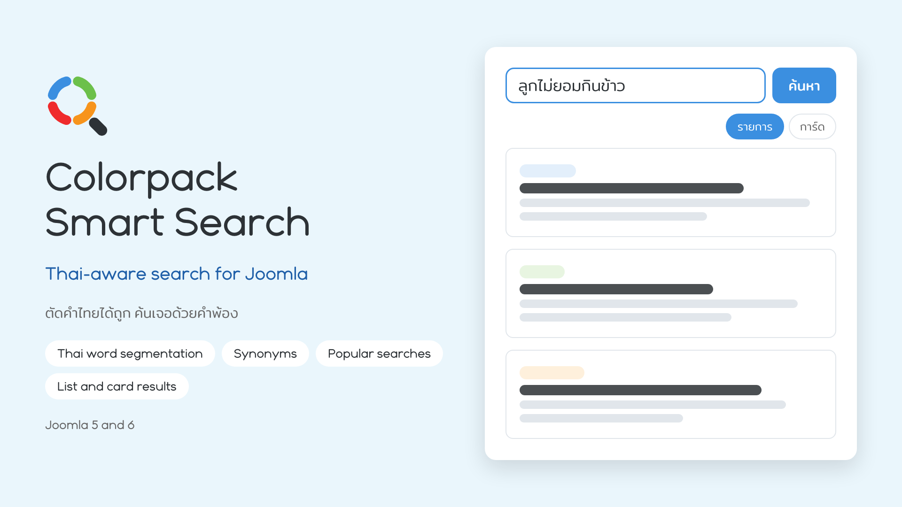

# Colorpack Smart Search



**ไทย** · [English](#english)

ระบบค้นหาภาษาไทยสำหรับ Joomla ที่ **ตัดคำไทยได้ถูกต้อง** จัดอันดับผลด้วย BM25 และรองรับ **คำพ้อง** ไม่ต้องใช้บริการภายนอก ไม่ต้องมี API key และไม่มี AI

## ทำอะไรได้

- **ตัดคำไทย** ด้วย ICU (ส่วนขยาย PHP `intl`) ค้นได้แม้ไม่มีเว้นวรรคระหว่างคำ
- **จัดอันดับผล** ด้วย BM25 โดยให้น้ำหนักชื่อเรื่องและแท็กมากกว่าเนื้อหา
- **คำพ้อง** กำหนดเองได้ใน Options (หนึ่งกฎต่อบรรทัด เช่น `เบื่ออาหาร = กินยาก, เบื่อข้าว`)
- **คำค้นยอดนิยม** ใต้ช่องค้นหา สร้างอัตโนมัติจากประวัติการค้นหาจริง (ไม่แสดงคำที่ไม่มีผลลัพธ์ และคำที่ดูเหมือนอีเมล เบอร์โทร หรือลิงก์)
- **แสดงผลสองแบบ** คือรายการและการ์ด ให้ผู้เข้าชมสลับได้ หรือกำหนดแบบเดียว
- **Choose a Layout ในเมนู** ตามมาตรฐาน Joomla และสร้างเลย์เอาต์เองได้ผ่าน template override ([คู่มือ](docs/LAYOUTS.md))
- **เข้ากับเทมเพลต** ใช้มาร์กอัป UIkit กับ YOOtheme, Bootstrap 5 กับ Cassiopeia หรือสไตล์ของส่วนขยายเองกับเทมเพลตอื่น
- **รูปประกอบผลลัพธ์** ดึงจาก Intro Image, Full Article Image, รูปแรกในเนื้อหา หรือฟิลด์รูปของ FlexiContent
- **ดัชนีอัปเดตอัตโนมัติ** เมื่อบันทึก ลบ หรือเปลี่ยนสถานะบทความ (ปลั๊กอิน content)
- **แดชบอร์ดผู้ดูแล** แสดงสถานะดัชนี จำนวนการค้นหา 30 วัน คำค้นยอดนิยม และคำที่ไม่มีผลลัพธ์

## ความต้องการและสถานะการทดสอบ

| รายการ | สถานะ |
|---|---|
| Joomla 5.4.10 | ทดสอบแล้ว |
| Joomla 6.2.0 | ทดสอบแล้ว (ติดตั้ง หน้าค้นหา แดชบอร์ด สร้างดัชนี Options) PHP 8.3 ขึ้นไปตามที่ Joomla 6 กำหนด |
| MySQL 8 | ทดสอบแล้ว |
| MariaDB | ยังไม่ได้ทดสอบ |
| PHP `intl` | ต้องเปิด การตัดคำไทยต้องใช้ ถ้าไม่มี ผลค้นหาภาษาไทยจะแม่นยำน้อยลงมาก แดชบอร์ดจะแจ้งเตือน |
| ขนาดเว็บที่ทดสอบ | ประมาณ 3,300 บทความ |

## ติดตั้ง

1. ดาวน์โหลด `colorpack_smart_search.zip` จากหน้า Releases (หรือสร้างเองด้วย `./build.sh`)
2. Joomla ผู้ดูแล → System → Install → Extensions แล้วอัปโหลดไฟล์ zip
3. Components → Colorpack Smart Search → กด **Build index**
4. สร้างเมนู: Menus → New Menu Item → **Colorpack Smart Search → Search page** แล้วเลือกเลย์เอาต์ในช่อง *Choose a Layout*
5. ปรับแต่งที่ปุ่ม **Options** (หน้าตา ฟอนต์ คำพ้อง คำค้นยอดนิยม รูป การแบ่งหน้า)

## ข้อควรรู้

- ระบบนี้เป็นหน้าค้นหาของตัวเอง **ไม่ได้เชื่อมกับ Smart Search (com_finder) ของ Joomla**
- ข้อความบนหน้าค้นหาฝั่งผู้เข้าชม (เช่น "ค้นหา", "รายการ", "การ์ด") ตอนนี้เป็นภาษาไทยอย่างเดียว ส่วนหน้าผู้ดูแลมีทั้งอังกฤษและไทย (th-TH)
- ฟอนต์เริ่มต้นคือ Noto Sans Thai **โหลดจาก Google Fonts** ซึ่งส่งคำขอของผู้เข้าชมไปที่ Google เลือก "ตามเทมเพลต" ใน Options เพื่อไม่โหลดฟอนต์ภายนอก
- ระบบเก็บคำค้นของผู้เข้าชมในตาราง `#__aisearch_log` เพื่อทำสถิติและคำค้นยอดนิยม ควรแจ้งไว้ในนโยบายความเป็นส่วนตัวของเว็บ
- ชื่อภายในของส่วนขยายยังเป็น `com_aisearch` (เพื่อความเข้ากันได้กับชุดอื่นของ Colorpack) แต่ชื่อที่แสดงคือ Colorpack Smart Search

## สร้างแพ็กเอง

```bash
./build.sh
```

ได้ไฟล์ `dist/colorpack_smart_search.zip`

## สัญญาอนุญาต

GNU General Public License เวอร์ชัน 2 หรือใหม่กว่า (GPL-2.0-or-later) ดูไฟล์ [LICENSE](LICENSE)

© บริษัท คัลเลอร์แพค ครีเอชั่น จำกัด · [colorpack.co.th](https://colorpack.co.th)

---

<a id="english"></a>

# Colorpack Smart Search (English)

[ไทย](#colorpack-smart-search) · **English**

Thai-aware search for Joomla: **correct Thai word segmentation**, BM25 ranking and **synonyms**. No external services, no API keys, no AI.

## What it does

- **Thai word segmentation** with ICU (the PHP `intl` extension), so searches work without spaces between words
- **BM25 ranking**, weighting titles and tags above body text
- **Synonyms**, edited in Options (one rule per line, e.g. `sofa = couch, settee`)
- **Popular searches** under the search box, built automatically from the real search log (searches with no result, and anything that looks like an email, phone number or link, are never shown)
- **Two result layouts**, List and Cards, with an optional visitor switch or one fixed layout
- **Choose a Layout on the menu item**, the Joomla way, and your own layouts through template overrides ([guide](docs/LAYOUTS.md))
- **Fits your template**: UIkit markup for YOOtheme, Bootstrap 5 for Cassiopeia, or the extension's own styles elsewhere
- **Result pictures** from the Intro Image, the Full Article Image, the first image in the text, or a FlexiContent image field
- **The index updates itself** when an article is saved, deleted or changes state (content plugin)
- **Admin dashboard**: index status, searches in the last 30 days, top searches and searches with no result

## Requirements and test status

| Item | Status |
|---|---|
| Joomla 5.4.10 | Tested |
| Joomla 6.2.0 | Tested (install, search page, dashboard, index build, Options). PHP 8.3 or newer, as Joomla 6 requires |
| MySQL 8 | Tested |
| MariaDB | Not tested |
| PHP `intl` | Required. Thai segmentation needs it. Without it Thai results are much less accurate, and the dashboard shows a warning |
| Site size tested | About 3,300 articles |

## Install

1. Download `colorpack_smart_search.zip` from Releases (or build it with `./build.sh`).
2. Joomla administrator → System → Install → Extensions, then upload the zip.
3. Components → Colorpack Smart Search → press **Build index**.
4. Create a menu item: Menus → New Menu Item → **Colorpack Smart Search → Search page**, and pick a layout in *Choose a Layout*.
5. Adjust things with the **Options** button (appearance, fonts, synonyms, popular searches, images, pagination).

## Good to know

- This is its own search page. It is **not connected to Joomla's Smart Search (com_finder)**.
- The visitor-facing strings on the search page (for example "ค้นหา", "รายการ", "การ์ด") are currently Thai only. The administrator side is available in English and Thai (th-TH).
- The default font is Noto Sans Thai, **loaded from Google Fonts**, which sends visitors' requests to Google. Choose "From the template" in Options to load no external font.
- Visitors' search terms are stored in the `#__aisearch_log` table for statistics and popular searches. Mention this in your site's privacy policy.
- The internal extension name is still `com_aisearch` (kept for compatibility with other Colorpack builds); the name shown is Colorpack Smart Search.

## Build it yourself

```bash
./build.sh
```

This produces `dist/colorpack_smart_search.zip`.

## Licence

GNU General Public License, version 2 or later (GPL-2.0-or-later). See [LICENSE](LICENSE).

© Colorpack Creation Co., Ltd. · [colorpack.co.th](https://colorpack.co.th)
